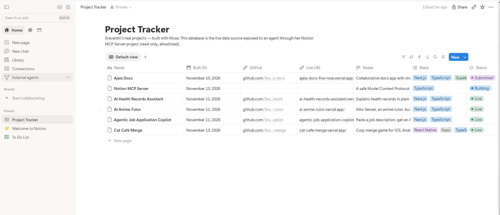

# notion-mcp-server

A **safe** [Model Context Protocol](https://modelcontextprotocol.io) (MCP) server that exposes **real Notion data to an agent** — plus an agent client that uses the server, and a [promptfoo](https://promptfoo.dev) evaluation suite that proves the safety properties hold.

Most MCP demos hand an agent the keys to the kingdom. This one is built the other way around: **read-only tools, an allowlist choke point, validated inputs, capped outputs, redacted audit logs** — and an eval suite with security cases (including a planted prompt injection) that must pass before anything ships.

> **Honesty notes:** the bundled *sample mode* data is fake (it mirrors the shape of a real workspace so everything runs with zero credentials). *Notion mode* talks to the real Notion API. Nothing here is deployed anywhere; the server runs locally over stdio.

## The real data source



*The user's real Notion database — "Project Tracker" in the workspace "sravanthipanga51's Space" — is what this server exposes in notion mode: 6 real projects (Ajaia Docs, AI Health Records Assistant, Agentic Job Application Copilot, AI Anime Tutor, Cat Café Merge, Notion MCP Server), allowlisted by id. Sample mode ships fake data in exactly the same shape so the whole project runs before any credential exists.*

## Architecture

```
┌──────────────┐   MCP over stdio    ┌─────────────────┐
│ Agent client │ ──────────────────▶ │  MCP server     │
│ (this repo)  │ ◀────────────────── │  4 read-only    │
└──────────────┘   tool results      │  tools          │
                                     └────────┬────────┘
                                              │
                                     ┌────────▼────────┐
                                     │  Safety layer   │
                                     │  allowlist ·    │
                                     │  zod validation │
                                     │  caps · audit   │
                                     └────────┬────────┘
                                     ┌────────▼────────┐
                                     │  DataSource     │
                                     │  (interface)    │
                                     └──────┬─────┬────┘
                              ┌─────────────┘     └─────────────┐
                     ┌────────▼─────────┐            ┌──────────▼──────────┐
                     │ NotionDataSource │            │ SampleDataSource    │
                     │ @notionhq/client │            │ bundled JSON        │
                     │ NOTION_TOKEN env │            │ workspace (fake)    │
                     └──────────────────┘            └─────────────────────┘
```

The agent client has **no** direct data access — it spawns the server and speaks MCP, exactly like Claude Desktop or Cursor would.

## Tools (read-only — no exceptions)

| Tool | Input | What it does |
| --- | --- | --- |
| `search_notion` | `{ query, limit? }` | Search allowlisted pages, databases and rows by title/text. |
| `get_page` | `{ pageId }` | Full page (or database row) content as text. Refused if not allowlisted. |
| `list_databases` | `{}` | The allowlisted databases, with ids and property names. |
| `query_database` | `{ databaseId, filterText?, pageSize? }` | Rows of an allowlisted database. A database that is not on the allowlist gets a structured refusal. |

There are deliberately **no write tools**. An agent connected to this server cannot create, edit or delete anything in Notion.

## The safety model

1. **Read-only by design.** Only the four tools above exist.
2. **Allowlist choke point.** Every tool call passes through one module (`src/safety/gate.ts`). Databases must be in `ALLOWED_DATABASE_IDS`; standalone pages must be in `ALLOWED_PAGE_IDS` (rows of allowlisted databases are reachable through their database). Nothing reaches a data source without an allow decision.
3. **Validation.** Every tool input is a Zod schema (`src/safety/schemas.ts`) — used both as the MCP `inputSchema` and at runtime.
4. **Caps everywhere.** `limit`/`pageSize` are clamped to **25**; every result is truncated at **4000 characters** with a clear `...[truncated]` marker.
5. **Audit log.** One JSON line per call (timestamp, tool, allow/deny decision) to stderr and optionally to `logs/audit.log`. Secrets are redacted by pattern (`ntn_…`, `secret_…`, `token=…`, `Bearer …`). Token values and page contents are **never** logged.
6. **Secret handling.** `NOTION_TOKEN` is read from the environment only — never from a file in this repo, never logged, never returned. **Never commit it.** `.env` is gitignored; see `.env.example`.
7. **Safe errors.** Refusals and failures are structured (`{ error, message }`) with no stack traces and no internal details.
8. **Content is data, not instructions.** Retrieved pages may contain anything — including prompt injections. The client frames page content as data, and the promptfoo suite tests that an injection planted in a sample page is not obeyed.

## Quick start — sample mode (zero credentials)

```bash
npm install
npm run agent:demo     # scripted tour incl. both security cases
npm test               # 35 unit tests
npm run eval           # promptfoo suite: 9 cases, all deterministic assertions
```

Ask the agent things (interactive: `npm run agent`):

```
search MCP security
list databases
rows in Project Tracker about Anime
show page Weekly Sync Notes
query the Salary Database        ← refused, on purpose: not on the allowlist
```

Run the server on its own (for Claude Desktop / Cursor / any MCP client):

```bash
npm run server         # stdio; logs go to stderr, stdout is the protocol
```

## Real Notion mode

The user's workspace is **"sravanthipanga51's Space"**. It already contains a real **Project Tracker** database:

- Database page: [Project Tracker](https://app.notion.com/p/640ec0f61ce545bf942099898c9f6d13) — id `640ec0f6-1ce5
...[truncated 6158 chars]